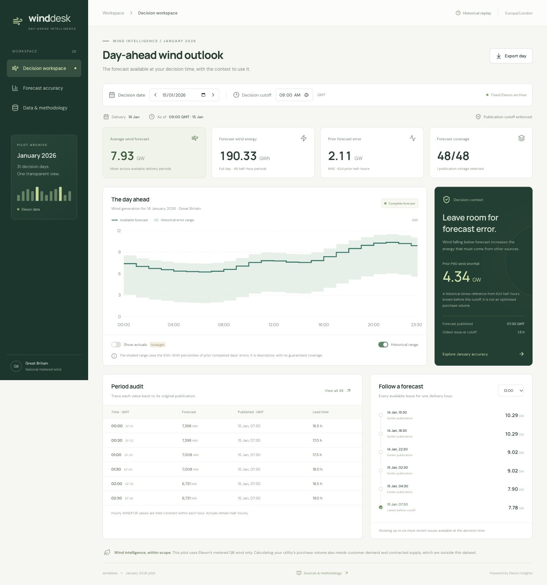

# Wind Desk

A React and Python pilot for replaying day-ahead wind decisions in January 2026. It answers two questions: **what wind forecast was available at the decision cutoff, and how far did that forecast differ from actual generation?**

The app uses real Elexon WINDFOR and FUELHH data. The small source archive is included, so reviewers can run the product without an API key or an upstream data download.

**Live application:** add your production Vercel URL here after deployment.

**Demo video:** add your unlisted YouTube URL here after recording.



## Run locally

Use Python 3.12+ and Node.js 22.12+ (Node 22 is recommended).

```bash
python3.12 -m venv .venv
source .venv/bin/activate
python -m pip install -r requirements-dev.txt
npm ci --prefix frontend
npm run build --prefix frontend
python -m uvicorn backend.app.main:app --host 127.0.0.1 --port 8000
```

Open [http://localhost:8000](http://localhost:8000). Interactive API documentation is at [http://localhost:8000/api/docs](http://localhost:8000/api/docs).

Once dependencies have been installed and the frontend built, `./scripts/run-local.sh` starts the application. The local handover folder already has these dependencies and a production build, but ignored dependencies are not part of a Git clone.

For frontend development, run the Python server above, then run `npm run dev --prefix frontend` in a second terminal. Vite serves the frontend on port 5173 and proxies `/api` to Python on port 8000. Rebuild the frontend before using port 8000 for a production-style demo.

## Run with Docker

With Docker Desktop or Docker Engine running:

```bash
docker compose up --build
```

Open [http://localhost:8000](http://localhost:8000). To stop it, run `docker compose down`. If a local Python server already uses port 8000, stop that server first.

The multi-stage Dockerfile builds React with Node and serves the resulting assets and API from a non-root Python container. The archive is bundled in the image; it is not downloaded at startup. A health check verifies the data files. Docker is the portable runtime; Vercel uses its native Python function and static hosting rather than this image.

## Deploy to Vercel

1. Push this folder as the root of a public GitHub repository with an anonymous name, for example `q7m4x9`.
2. Import that repository in Vercel. Keep **Root Directory** at the repository root, **not** `frontend`.
3. Use **Framework Preset: Other**. The committed `vercel.json` sets `framework: null` and supplies:
   - Install: `npm ci --prefix frontend`
   - Build: `npm run build --prefix frontend`
   - Output: `frontend/dist`
4. Deploy. No environment variables or API keys are required.
5. Check `/`, `/api/health`, `/api/decision`, and `/api/accuracy` on the production domain. `/api/health` should return `status: "ok"`.
6. Put the production URL in this README. Verify the app, repo and video in a private/incognito browser before submitting.

`api/index.py` exposes the same FastAPI application used locally. `/api/*` requests are rewritten to that Python function; the built React files are served as static assets. Python source and the data archive are included in the function bundle. `.vercelignore` excludes local dependencies, tests and scratch caches. See the [deployment guide](docs/DEPLOYMENT.md) for commands and troubleshooting.

## Product walkthrough

- **Decision workspace:** select any January decision date and a cutoff in London time; see next-day forecast power and energy, forecast coverage, historical error context, and an auditable publication history. Actuals are hidden by default and explicitly labelled as hindsight when enabled.
- **Forecast accuracy:** compare daily and hourly errors at one consistent cutoff. Inspect MAE, RMSE, signed bias, WAPE, error direction and the largest individual misses. Click a decision day to investigate it.
- **Data and methodology:** inspect source records, checksum provenance, date boundaries, assumptions and metric definitions.
- **CSV exports:** download day or month records, including selected publication timestamps, actuals, errors and lead times. Exports are retrospective audit records and include actuals regardless of the chart's hindsight toggle.

The date, cutoff and current view are encoded in the URL for reproducible links.

## Analysis decisions

The brief specifies **purchase decisions made in January 2026**. Therefore decision dates are 1–31 January and next-day delivery dates are **2 January–1 February**. This interpretation is displayed in the app. December forecast publications are fetched only to support the early January decision cutoffs; the scored decisions remain entirely in January.

The default cutoff is **09:00 Europe/London**, a configurable pilot policy, not a universal market gate-closure claim. January is GMT/UTC+0. For each target hour, the backend selects the record with the greatest `publishTime` satisfying `publishTime <= cutoff`. It never selects a later forecast simply because it is more accurate. Publication timestamps are a proxy for information availability; actual system receipt latency is not available.

The fetched WINDFOR archive is hourly. Each forecast is held constant over the two half-hours inside that exact hour and compared with half-hour FUELHH WIND actuals. This is an explicit alignment assumption. No interpolation or forward fill across missing hours is used. The adapter rejects an unexpected forecast resolution so a source change cannot silently alter the analysis.

All power values are MW. Energy is the sum of half-hour MW values multiplied by 0.5 hours. Full-day forecast energy is withheld if any period is missing. Missing values never become zero. Scores use matched periods and expose the number of expected and matched periods.

With error `e = forecast − actual`:

- MAE = mean of `|e|`.
- RMSE = square root of mean `e²`.
- Bias = mean `e`; positive means wind was overforecast.
- WAPE = `100 × sum(|e|) / sum(actual)` on the matched sample. It is undefined if the actual total is zero. Unlike MAPE, it does not divide by individual low-wind periods.
- Historical P90 shortfall = `max(0, quantile(e, 0.9))` on prior completed delivery days. The shaded range is `forecast − q90(e)` to `forecast − q10(e)`, floored at zero.

The historical range is strictly walk-forward: only completed earlier delivery days and actual publications available by the selected decision cutoff can enter it. It is unavailable until 48 prior matched half-hours exist. It is a descriptive stress reference, **not a calibrated prediction interval, purchase recommendation or guarantee**. Half-hours are correlated, and January alone is a short sample.

## Results from the included archive

At 09:00 GMT, all **1,488** expected half-hours have both a selected forecast and an actual:

- MAE: **2,041.96 MW**.
- RMSE: **2,509.06 MW**.
- Bias: **+1,747.89 MW**.
- WAPE: **18.10%**.
- Forecast exceeded actual in **84.74%** of matched periods.

These are retrospective results, not estimated future performance. A 15 January decision covers 16 January delivery: mean forecast **7.93 GW**, forecast energy **190.33 GWh**, and a latest selected issue at **07:30 GMT**. The app calculates these values from the archive; they are not hardcoded into its display.

WINDFOR covers metered wind visible to the system operator, and FUELHH is generation outturn for Great Britain. This is not all UK renewable output. Curtailment, revisions and coverage differences may contribute to the forecast–outturn gap. The two datasets cannot isolate weather forecast skill or explain causality. The archive contains values retrieved after the historical period; publication filtering cannot reconstruct unreported historical corrections.

Demand, contracted supply, prices and the client's share of national wind are outside scope. The app therefore quantifies wind uncertainty without inventing thermal procurement volumes or financial savings.

## Data acquisition and reproducibility

```bash
source .venv/bin/activate
python scripts/fetch_data.py
# To refetch from Elexon instead of using the request cache:
python scripts/fetch_data.py --refresh
```

The script queries daily ranges with bounded concurrency, timeouts and retries. WINDFOR is fetched by **publication time**, preserving all vintages. FUELHH is fetched by settlement date with `fuelType=WIND`. Identical overlapping rows are deduplicated. The manifest records request URLs, acquisition timestamps, record counts, time ranges and SHA-256 checksums. Conflicting same-time values, unexpected fuel types and invalid numbers are rejected by the backend. A missing or corrupted archive returns a visible HTTP 503 rather than fabricated data.

The committed snapshot contains 19,272 forecast rows and 1,536 actual rows, retrieved on 26 October 2026. `retrieved_at` records the last source response acquisition time; rebuilding from cache preserves the original acquisition times. `snapshot_created_at` records the subsequent archive assembly time. Restart the Python process after refreshing so its in-memory index and response caches are rebuilt.

## Structure

```text
api/index.py                 Vercel ASGI entry point
backend/app/analysis.py      Validation, revision index, cutoff selection and metrics
backend/app/main.py          FastAPI endpoints, CSV export, health and static hosting
backend/tests/               Numerical, temporal, source-integrity and API tests
frontend/src/App.tsx         Product views and chart/table components
frontend/src/api.ts          Abortable fetch hook with loading/error states
frontend/src/types.ts        Typed API contracts
frontend/src/styles.css      Responsive visual design and accessible controls
frontend/public/            Favicon
frontend/package-lock.json  Reproducible frontend dependency resolution
data/                       Elexon snapshot and provenance manifest
scripts/fetch_data.py        Reproducible Elexon ingestion command
scripts/run-local.sh         Start the prepared local production build
docs/ARCHITECTURE.md         Technical review and implementation tradeoffs
docs/DEMO_SCRIPT.md          Two-part video script under ten minutes
docs/DEPLOYMENT.md           Git, Vercel and submission instructions
docs/VERIFICATION.md         Verified checks and environment limitations
Dockerfile, compose.yaml    Portable container runtime
vercel.json                 Static frontend and Python function deployment
.github/workflows/ci.yml    Tests, frontend build and Docker smoke test
```

## Tests

```bash
python -m pytest -q
npm run build --prefix frontend
npm audit --prefix frontend
```

The tests cover inclusive publication cutoffs, exclusion of later forecasts and actual revisions, hourly alignment, missing observations, zero generation, energy units, duplicate conflicts, January boundaries, timezones, CSV provenance and source checksums. The checked-in archive is used in an end-to-end regression test; normal test execution does not call Elexon. GitHub Actions also builds the container and requests its health endpoint.

## AI assistance

**OpenAI Codex was used to assist with implementation, data investigation, interface design, tests and documentation.** The included data was fetched from Elexon; AI-generated data is not used. See `docs/VERIFICATION.md` for the checks actually executed and the remaining deployment/container verification steps.

## Sources

- [FUELHH stream documentation](https://bmrs.elexon.co.uk/api-documentation/endpoint/datasets/FUELHH/stream)
- [WINDFOR stream documentation](https://bmrs.elexon.co.uk/api-documentation/endpoint/datasets/WINDFOR/stream)
- [Elexon forecast coverage description](https://bmrs.elexon.co.uk/api-documentation/endpoint/forecast/generation/wind/latest)
- [Elexon OpenAPI schema](https://data.elexon.co.uk/swagger/v1/swagger.json)
- [Vercel Python functions](https://vercel.com/docs/functions/runtimes/python/api-directory)

Source data remains attributable to Elexon and its upstream providers. This repository does not claim ownership of, or apply a new licence to, that data.
